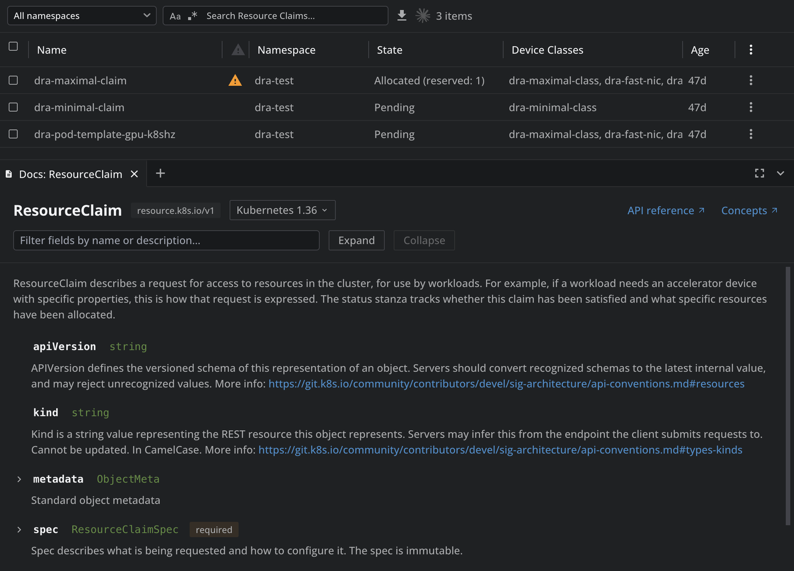

# Kubernetes Documentation for Lens

See what any Kubernetes resource and every one of its fields means, without leaving Lens. The extension shows the Kubernetes API reference for the resource you are looking at: what the kind is for, and for each field its type, whether it is required, and its description, like `kubectl explain`, but browsable and searchable.

## Features

- **Documentation for every resource, custom resources included.** Built-in kinds are documented from the Kubernetes API reference of Kubernetes 1.29 to 1.36, which comes bundled so it works offline. Custom resources are documented from the schema of their CustomResourceDefinition in the cluster, so you see exactly what your operators declare, and APIs that add-ons serve, such as `metrics.k8s.io`, from the schema the cluster serves for them.
- **A field browser in the dock.** Expand `spec`, then `containers`, then `resources`, and read each field's type (`string`, `[]Container`, `map[string]Quantity`), whether it is required, and its description. Custom resources also show allowed values, defaults and validation rules.
- **Search across all fields.** Type part of a name or a description (`image`, `toleration`, `grace period`) to list every matching field by its full path, such as `spec.template.spec.containers[].image`, then jump to it in the tree.
- **A Documentation section in the details panel** of every built-in resource, saying what the kind is for, with links to browse its fields.
- **Matched to the Kubernetes version your cluster runs**, which the extension asks the cluster for, so every field you read exists in your cluster. A cluster running a version newer or older than the bundled ones is documented from the API schema it serves itself, so the documentation never falls behind. A version menu shows another version's documentation when you want to compare.
- **Links to kubernetes.io**: the API reference page of the kind, and the concept page explaining it where there is one.
- **A window of its own.** Open the documentation in a window beside Lens, to read it next to the resource you are editing, from the tab's header or its right-click menu. Lens's window layouts open it again where you left it.
- **Reach it from wherever a kind is named.** Right-click a page in the navigator, Pods or a custom resource's, or a link to a list of resources, and choose **Documentation**; or run **Documentation: Browse a kind** from the command palette to pick any kind the cluster serves.

## Install

[Open Kubernetes Documentation in Lens](https://app.k8slens.dev/lens-launcher?c=lens%3A%2F%2Fapp%2Fopen%2Fextension%3Fname%3D%40k8slens%2Fkube-documentation) and click Install there. The link offers Lens for download when it is not installed yet.

## Usage

- **From a resource list:** right-click any resource, or open the ⋮ menu at the end of its row, and choose **Documentation**. A **Docs: ‹Kind›** tab opens in the dock at the bottom of the cluster view. There is one such tab per kind, and opening it again brings it forward; the cluster is connected first when it is not.
- **From the navigator:** right-click a page that lists a kind, such as Pods, Deployments or a custom resource's page, and choose **Documentation**.
- **From a link to a list:** right-click a link to a list of resources, in a details panel or the cluster overview, and choose **Documentation**.
- **From the command palette:** run **Documentation: Browse a kind** while looking at a cluster, type part of a kind's name, plural or short name, and pick it, or press Enter for the first match. The list is every kind the cluster serves, in the API version it serves it in.
- **From a resource's details:** scroll to the **Documentation** section at the end of the details panel and choose **Browse fields**, **API reference** or **Concepts**.
- **In the documentation tab:** click a field with an arrow to expand it, or use **Expand** and **Collapse** for the first levels at once. Type in the filter box to search the fields, and choose **Show in tree** on a result to see it in place. Links in descriptions open in your browser. **Open in a window**, in the header or in the tab's right-click menu, shows the same documentation in a window of its own.

Built-in kinds are documented as of the Kubernetes version shown in the tab's header: the one your cluster runs. For a version the extension does not bundle, the documentation is read from the cluster's own API schema, marked **From the cluster**; should that fail, the nearest bundled version is shown, and the header says so. Choose another version from its menu to look at that version until you choose the cluster's again. When the cluster cannot be asked for its version, the menu chooses the version it runs instead, and the choice is remembered for that cluster; the menu also offers to ask the cluster again, and the extension asks by itself whenever Lens connects to the cluster. The details panel follows the same version. When your cluster serves an API version of a kind that the chosen Kubernetes version does not have, the closest one it does have is shown, and the header says so.

## Ask AI

From any Ask AI conversation about a cluster, you can also:

- Ask what a kind or one of its fields means, such as what `spec.strategy.rollingUpdate.maxSurge` of a Deployment does. The answer comes from the documentation of the Kubernetes version the cluster runs, or from the custom resource's own definition.
- Ask which field does something, such as which Deployment field sets the termination grace period.
- Ask what changed in a kind between two Kubernetes versions, such as which Pod fields were added between 1.31 and 1.36, when planning an upgrade.
- Ask it to open the documentation of a kind, or of one of its fields, in Lens.

What changed in each version is in [CHANGELOG.md](./CHANGELOG.md).
